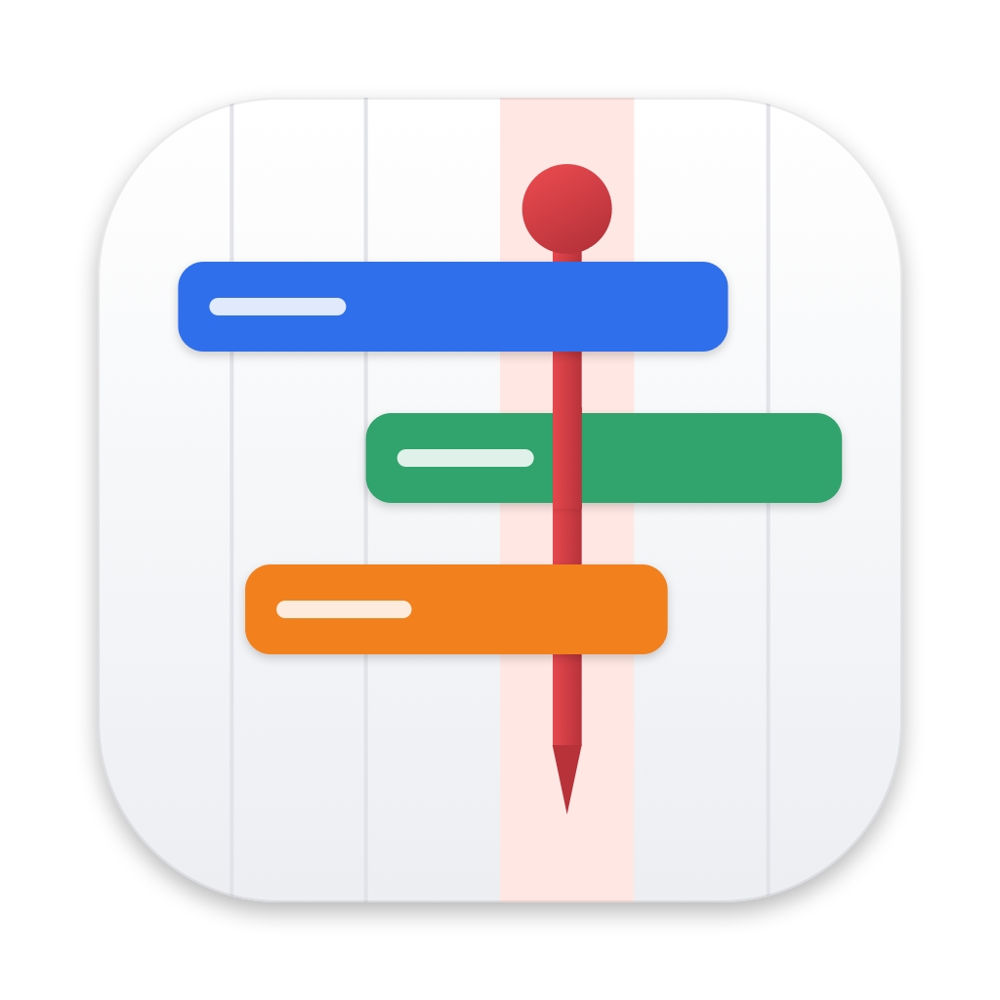
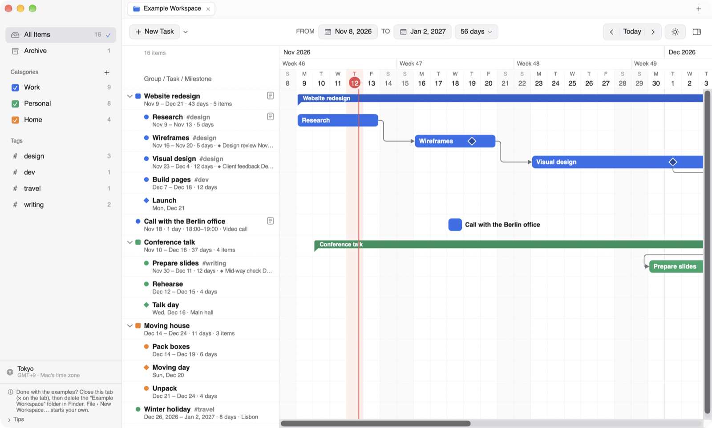

<p align="center">
  
</p>

# DaySpindle

A Gantt chart task manager for macOS and Windows. Plan **groups**, **tasks** and **milestones** on a day-by-day timeline. Join them with **dependency arrows**, color them by category, tag them, and drag their bars to reschedule.

It runs entirely on your computer: no account, no cloud service, no network access. Everything is saved in a **workspace folder** you choose. The Mac and Windows versions open the same workspace folders, so you can keep one in iCloud Drive, OneDrive or on a USB stick, or move it between a Mac and a PC.



**Version 2.1.** Developed by **Ruichen Li**. Free for everyone to use under the [MIT License](LICENSE). If you share it, keep the author's name with it.


## Choose your version

| | macOS | Windows |
|---|---|---|
| **Download** | [`DaySpindle-2.1-macOS.zip`](macOS/DaySpindle-2.1-macOS.zip) (2.9 MB) | the [`Windows`](Windows) folder: [`Start DaySpindle.cmd`](Windows/Start%20DaySpindle.cmd) and the app in 8 parts in [`package`](Windows/package) (151 MB in all) |
| **Needs** | macOS 14 Sonoma or later, on Apple silicon or Intel | Windows 10 (version 1803 or later) or Windows 11, 64-bit (Windows 11 on Arm runs it through emulation) |
| **Size once unpacked** | about 10 MB | about 360 MB |
| **Made with** | Swift (AppKit and SwiftUI), a native Mac app | Electron |
| **Full instructions** | [macOS README](macOS/README.md) | [Windows README](Windows/README.md) |

The two versions look and work the same way. Each folder also holds an **`Example Workspace`** to try things out, and the app's source code in `source`.

GitHub accepts files of at most 25 MB through its web page, so the Windows app is split into 8 parts of at most 20 MB. The first time you run it, [`Start DaySpindle.cmd`](Windows/Start%20DaySpindle.cmd) puts the parts back together on Windows, checks the result and unpacks the app, without any extra software.


## What's new in 2.1

- **Groups, tasks and milestones.** A task with subtasks becomes a group that spans everything inside it. A milestone can have its own row, or sit on a task's bar to mark a key moment such as a review or a deadline.
- **Dependency arrows** between items (Finish → Start and the other three types). An arrow can leave from and arrive at any of an item's four sides, and each arrow has its own color and thickness.
- **A details pane on the right.** Double-click an item or an arrow to see and edit everything about it.
- **Completed and the Archive.** Mark an item as completed, whether you finished on time or early. It moves to the **Archive** in the sidebar, together with everything inside it. Unmark it there and it returns to exactly where it was.
- **Time zones,** like Calendar: an item with a time keeps the moment it was entered in, and shows in the time zone you choose.
- **Workspaces and tabs.** Each workspace is a folder you choose, and several can be open at once, each in its own tab along the top of the window.
- **An Example Workspace** that opens by itself the first time, and **Tips** you can unfold at the bottom left of the window.

Everything that changed since 2.0, in short: [CHANGELOG.md](CHANGELOG.md). Coming from 2.0? Your tasks aren't lost. See [Upgrading from 2.0](#upgrading-from-20).


## Features

- A timeline with a month bar, week numbers and weekdays. Choose the range with From/TO dates or a time scale from 1 Week to 1 Year, and scroll sideways through time.
- Items with start and end dates, optional start and end times and time zone, location and notes. Groups can be collapsed.
- Categories with colors and notes, each with a checkbox to show or hide its items. Tags work as filters, and they combine with categories.
- Drag a bar to move an item, drag its ends to change its dates, and drag rows to reorder items and categories. Dragging a group moves everything inside it.
- Light, Dark or System appearance, a Today color you choose, and Sunday, Monday or Saturday as the first day of the week.
- Undo and redo for every change. Each change is saved straight away.


## Download

- **Both versions at once (easiest):** click the green **Code** button at the top of this page, choose **Download ZIP** (about 155 MB), and unzip it. The Mac version is in its `macOS` folder, the Windows version in its `Windows` folder, each with its `Example Workspace`.
- **With git:** `git clone` this repository.

GitHub's web page doesn't download single folders, so the full download is the simplest way to get an app together with its Example Workspace. To get only the Mac app, open [`macOS/DaySpindle-2.1-macOS.zip`](macOS/DaySpindle-2.1-macOS.zip) and click the download button (**Download raw file**) at the top right. It works without the Example Workspace: choose **File › New Workspace…** to start your own.


## Install on a Mac

1. Open the `macOS` folder and double-click `DaySpindle-2.1-macOS.zip`. `DaySpindle.app` appears next to it, beside the `Example Workspace` folder.
2. Open `DaySpindle.app`. It isn't signed by an Apple-registered developer or notarized by Apple, so macOS blocks it the first time:
   - **macOS 15 or later:** click **Done**. Open **System Settings › Privacy & Security**, scroll down, click **Open Anyway** next to the message about DaySpindle, and confirm.
   - **macOS 14:** right-click the app, choose **Open**, then click **Open**.

   macOS remembers your choice, so you do this only once.
3. The Example Workspace opens by itself. If you see the welcome screen instead, choose **Open Workspace…** and pick the `Example Workspace` folder.

You can move `DaySpindle.app` to your Applications folder whenever you like. All the details are in the [macOS README](macOS/README.md).


## Install on Windows

1. Open the `Windows` folder and double-click **`Start DaySpindle.cmd`**. Keep everything in the `Windows` folder together.
   - If Windows says **"Windows protected your PC"**, click **More info**, then **Run anyway**. The app isn't signed by a publisher, so Windows doesn't recognize it yet.
   - If Windows asks whether to run a file downloaded from the internet, choose **Run**.
2. The first time, it joins the 8 parts, checks that nothing is damaged (SHA-256) and unpacks the app into a new folder, `DaySpindle for Windows`. This takes about a minute. Then DaySpindle opens with the Example Workspace.
3. After that, start DaySpindle the same way, or double-click `DaySpindle.exe` in the `DaySpindle for Windows` folder. To pin it, right-click `DaySpindle.exe` and choose **Pin to taskbar** or **Pin to Start**.

All the details, including troubleshooting, are in the [Windows README](Windows/README.md).


## The Example Workspace

A small made-up plan: three groups (*Website redesign*, *Conference talk*, *Moving house*), milestones on their own rows and on task bars, arrows leaving and arriving at different sides, a completed task in the Archive, and a call entered in Berlin time.

When you're done with it, close its tab (the **×** on the tab), then delete the `Example Workspace` folder. The note at the bottom left of the window says the same while it's open. To start your own, choose **File › New Workspace…** and pick a folder (use **New Folder** in the dialog to make one): that folder becomes the workspace, and its tab is named after it.


## Upgrading from 2.0

DaySpindle 2.0 kept all your tasks in one file inside your user folder. 2.1 keeps them in workspace folders you choose, and leaves the 2.0 file where it was. To bring your 2.0 tasks into 2.1:

1. Open DaySpindle 2.1 and choose **File › Import Tasks from DaySpindle 2.0…**. (The welcome screen also has a button for it.)
2. Choose a folder for them, for example a new folder `My Tasks` in Documents (use **New Folder** in the dialog). It becomes a workspace, and your tasks open in a tab named after it.

Your 2.0 tasks become groups and tasks, and keep their dates, categories and tags. The 2.0 file isn't changed, so you can run the import again. Once your tasks are in 2.1, you can delete the 2.0 app. The 2.0 file is in:

- **macOS:** `~/Library/Application Support/org.dayspindle.DaySpindle/dayspindle-data.json`
- **Windows:** `%APPDATA%\DaySpindle\dayspindle-data.json`


## Where your data is stored

| | macOS | Windows |
|---|---|---|
| **Your items** | `dayspindle-data.json`, in each workspace folder | `dayspindle-data.json`, in each workspace folder |
| **Automatic backup** | `dayspindle-data.previous.json`, in the same folder: the file as it was when the workspace was last opened | the same |
| **Your settings** (open tabs, time zone, appearance) | the app's preferences, `org.dayspindle.DaySpindle` | `%APPDATA%\DaySpindle\settings.json` |

Your workspaces are kept outside the app, so replacing the app with a newer version keeps them. To back up a workspace, copy its folder somewhere safe.


## Moving a workspace between a Mac and a PC

Copy the workspace folder to the other computer, or keep it in a folder both computers can see (iCloud Drive, OneDrive, Dropbox or a USB stick). On the other computer, choose **File › Open Workspace…** (⌘O on a Mac, Ctrl+O on Windows) and pick the folder. Use one computer at a time: close the workspace on one before you change it on the other.


## Keyboard shortcuts

| Action | Mac | Windows |
|---|---|---|
| New task / subtask | ⌘N / ⌥⌘N | Ctrl+N / Ctrl+Alt+N |
| New milestone / group / category | ⇧⌘M / ⇧⌘G / ⇧⌘N | Ctrl+Shift+M / Ctrl+Shift+G / Ctrl+Shift+N |
| Show details / show or hide the details pane | ⌘E (or Return) / ⌥⌘I | Ctrl+E (or Enter) / Ctrl+I |
| Mark as completed (to the Archive) / return from the Archive | ⇧⌘C | Ctrl+Shift+C |
| Move up / down among its siblings | ⌥⌘↑ / ⌥⌘↓ | Alt+↑ / Alt+↓ |
| Delete the selected item or arrow | Delete | Delete |
| Undo / redo | ⌘Z / ⇧⌘Z | Ctrl+Z / Ctrl+Y |
| Go to today | ⌘T | Ctrl+T |
| All items / clear filters | ⌘1 / ⌘K | Ctrl+1 / Ctrl+K |
| New workspace / open workspace | ⌃⌘N / ⌘O | Ctrl+Alt+Shift+N / Ctrl+O |
| Next or previous workspace tab / close the tab | ⌘} or ⌘{ / ⇧⌘W | Ctrl+Tab or Ctrl+Shift+Tab / Ctrl+W |
| Settings | ⌘, | Ctrl+, |
| Cancel a drag or an arrow being drawn | Esc | Esc |

On Windows the menus are in the window's menu bar, and **Settings…** is in the **File** menu.


## Removing DaySpindle

Your workspace folders stay where they are; delete them yourself if you no longer need them.

- **macOS:** quit DaySpindle and move `DaySpindle.app` to the Trash. To remove its settings too, run `defaults delete org.dayspindle.DaySpindle` in Terminal.
- **Windows:** delete the `Windows` folder (with `DaySpindle for Windows` inside). To remove its settings too, also delete `%APPDATA%\DaySpindle` and `%LOCALAPPDATA%\DaySpindle`.


## Privacy

DaySpindle has no account and doesn't connect to the internet. It doesn't collect, track or send any data. Everything you enter stays in your workspace folders and the settings listed under [Where your data is stored](#where-your-data-is-stored), on your own computer.


## What's in this repository

| File or folder | What it is |
|---|---|
| [`README.md`](README.md) | this page |
| [`CHANGELOG.md`](CHANGELOG.md) | what changed since the previous version |
| [`LICENSE`](LICENSE) | the MIT License |
| [`docs`](docs) | the [icon](docs/icon.png) and the screenshots of the [Mac](docs/screenshot.png) and [Windows](docs/screenshot-windows.png) versions |
| [`macOS`](macOS) | the Mac version: [`DaySpindle-2.1-macOS.zip`](macOS/DaySpindle-2.1-macOS.zip), its `Example Workspace`, its source code, and its [README](macOS/README.md) |
| [`Windows`](Windows) | the Windows version: [`Start DaySpindle.cmd`](Windows/Start%20DaySpindle.cmd), the app in 8 parts in `package`, its `Example Workspace`, its source code, and its [README](Windows/README.md) |

```
macOS/
├── DaySpindle-2.1-macOS.zip       the app; double-click to unzip DaySpindle.app
├── Example Workspace/             the example workspace
├── source/                        Swift sources and build.sh, which builds the zip
└── README.md                      install and use on a Mac

Windows/
├── Start DaySpindle.cmd           double-click to start; the first time, it puts the app together
├── package/                       the app as one zip in 8 parts (.001 to .008)
├── Example Workspace/             the example workspace
├── source/                        JavaScript, HTML and CSS on Electron, and build-windows.sh
└── README.md                      install and use on Windows
```

`DaySpindle.app` (unzipped on a Mac) and `DaySpindle for Windows` (unpacked on a PC) are made on your computer and aren't part of the repository.


## Building from source

- **macOS:** with Xcode or the Xcode Command Line Tools (`xcode-select --install`), run `./macOS/source/build.sh`. It builds the app for Apple silicon and Intel and writes `macOS/DaySpindle-2.1-macOS.zip` again.
- **Windows:** on a Mac, run `./Windows/source/build-windows.sh`. It downloads Node.js and Electron once and writes `Windows/package` and `Windows/Start DaySpindle.cmd` again. On Windows, to run the code directly, install [Node.js](https://nodejs.org), then in `Windows/source` run `npm install` and `npm start`.


## Developer, license and disclaimer

- **Developer:** DaySpindle is developed by Ruichen Li.
- **License:** [MIT License](LICENSE). In short:
  - **Everyone can use it** for free, for any purpose, including at work and in their own projects. You may also copy, change and share it.
  - **When you share it**, whether the original or a version you've changed, keep the line "Copyright (c) 2026 Ruichen Li" and the license text with it. Including the [`LICENSE`](LICENSE) file is the simplest way. This is how others know the app was developed by Ruichen Li.
  - If you mention DaySpindle somewhere or build on it, a credit such as "DaySpindle by Ruichen Li" with a link to this repository is appreciated.

  The [`LICENSE`](LICENSE) file is the binding text. This summary is only a guide to it.
- **No warranty:** DaySpindle is provided "as is", without warranty of any kind. The developer isn't liable for any loss or damage from using it, including lost tasks. Keep your own backup of anything important.
- **Third-party software:** the Mac version uses only Apple's system frameworks. The Windows version is built with Electron, which includes Chromium, Node.js and other open-source software under their own licenses. Their license texts come with the Windows version, in its `DaySpindle for Windows` folder, as `LICENSE` (Electron) and `LICENSES.chromium.html` (Chromium and the rest).
- **Unsigned apps:** neither app is signed by an Apple-registered developer or a Windows publisher. That is why macOS and Windows ask for confirmation the first time.
- **Trademarks:** Mac and macOS are trademarks of Apple Inc. Windows is a trademark of Microsoft Corporation. DaySpindle isn't affiliated with or endorsed by Apple or Microsoft.
