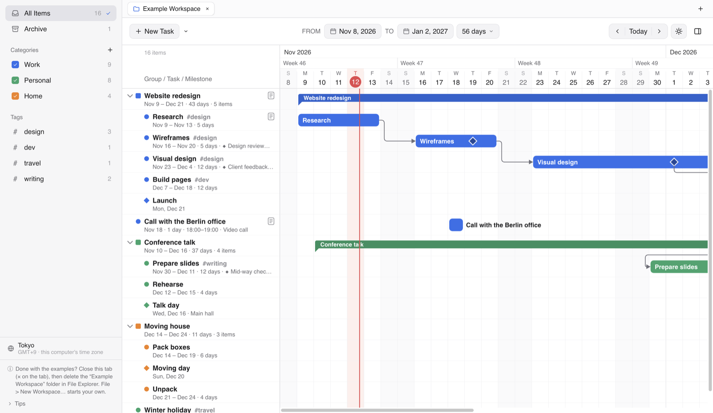

# DaySpindle for Windows

Version 2.1. Developed by Ruichen Li. Released under the [MIT License](../LICENSE).

[Main page](../README.md) · [macOS version](../macOS/README.md)

DaySpindle is a Gantt chart task manager. Plan **groups**, **tasks** and **milestones** on a day-by-day timeline. Join them with **dependency arrows**, color them by category, tag them, and drag their bars to reschedule. Everything is saved in a **workspace folder** you choose, which you can move to another computer or keep in OneDrive. It works fully offline: no account, no cloud service, no network access, and nothing to install.

**Needs:** Windows 10 (version 1803 or later) or Windows 11, 64-bit. Windows 11 on Arm also runs it, through emulation.

## Getting started

1. **Download this repository.** On its [main page](../README.md), click the green **Code** button, choose **Download ZIP**, then right-click the downloaded zip and choose **Extract All**. Or clone the repository with git. Open its `Windows` folder, and keep everything in it together. You can move the `Windows` folder anywhere, for example to `C:\Users\<your name>\DaySpindle` (avoid `C:\Program Files`).
2. **Double-click `Start DaySpindle.cmd`.** The first time, it rebuilds the app from the parts in the `package` folder, checks that nothing is damaged (SHA-256), and unpacks it into a new folder, `DaySpindle for Windows` (about 360 MB). This takes about a minute. Then DaySpindle opens.
   - If Windows says **"Windows protected your PC"**, click **More info**, then **Run anyway**. DaySpindle isn't signed with a paid certificate, so Windows doesn't recognize it yet.
   - If Windows asks whether to run a file downloaded from the internet, choose **Run**.
3. **The Example Workspace opens by itself** on the first start. Look around, change anything, and delete it when you're done (see below).

After that, start DaySpindle the same way, or double-click `DaySpindle.exe` in the `DaySpindle for Windows` folder. To pin it, right-click `DaySpindle.exe` and choose **Pin to taskbar** or **Pin to Start** (on Windows 11, under **Show more options**).

## The Example Workspace

The `Example Workspace` folder holds a small made-up plan:

- **Groups** (*Website redesign*, *Conference talk*, *Moving house*). A group spans everything inside it; drag it to move everything at once.
- **Tasks**, some with **milestones** drawn on their bars (*Design review*, *Client feedback*), and milestones with their own row (*Launch*, *Talk day*).
- **Arrows** between items, leaving and arriving at different sides: the usual end-to-start arrows, bottom-to-top arrows, and a red, thicker arrow.
- A **completed** task (*Submit abstract*), kept in the **Archive** (left sidebar) instead of the main list.
- A call entered in **Berlin time**, shown in your own time zone.

**Removing it:** close its tab (the **×** on the tab), then delete the `Example Workspace` folder in File Explorer. The note at the bottom left of the window says the same while it's open. Once its tab is closed, it doesn't open by itself again.

**Starting your own:** choose **File › New Workspace…** and pick a folder, for example one in Documents, OneDrive or on a USB stick (use **New folder** in the dialog to make one). That folder itself becomes the workspace, and its tab is named after it.

## Upgrading from DaySpindle 2.0

DaySpindle 2.0 kept all your tasks in one file, `%APPDATA%\DaySpindle\dayspindle-data.json`. 2.1 keeps them in workspace folders and leaves that file as it is. To bring your tasks in:

1. In DaySpindle 2.1, choose **File › Import Tasks from DaySpindle 2.0…** (the welcome screen also has a button for it).
2. Choose a folder for them, for example a new folder `My Tasks` in Documents (use **New folder** in the dialog). It becomes a workspace, and your tasks open in a tab named after it.

Tasks with subtasks become groups; dates, categories and tags stay as they were. Once your tasks are in 2.1, you can delete the folder with the 2.0 app (`DaySpindle-2.0-Windows-x64`).

## What you can do

- **Groups, tasks and milestones.** A task with subtasks becomes a group by itself. A milestone inside a task marks a key moment on its bar, such as a mid-term review or a deadline.
- **Dependency arrows.** Point at an item: four small round handles appear on its sides (left = its start, right = its end, top and bottom = the middle of its edges). Drag one onto another item. Each arrow's type (Finish → Start and so on), sides, thickness and color can be changed.
- **Details on the right.** Double-click an item or an arrow to see and edit everything about it in the pane on the right.
- **Completed and the Archive.** Mark an item as completed (**Ctrl+Shift+C**, the button in its details, or right-click) whether you finished on time or early; its dates stay as they were. It leaves the main list for the **Archive** (left sidebar, under All Items), together with everything inside it. Click **Archive** to see completed items, drawn faded with a check, and open their details. To bring one back, unmark it there (**Return from Archive** on right-click, Ctrl+Shift+C, or the button in its details): it returns to exactly where it was. A milestone on a task's bar stays on the bar when completed and gets a check.
- **Time zones,** like Calendar. An item with a time keeps the moment it was entered in: a 10:00 meeting entered in Tokyo shows as 02:00 in Berlin. Items without a time keep their dates everywhere. Choose the time zone at the bottom of the sidebar.
- **Workspaces and tabs.** Each workspace is a folder; open several, each in its own tab along the top of the window.
- **Categories and tags** with checkboxes and filters, **undo** for every change, **light and dark** appearance.
- **Tips** at the bottom left of the sidebar: click **Tips** to unfold or fold them.

## Keyboard shortcuts

| Action | Keys |
|---|---|
| New task / subtask | Ctrl+N / Ctrl+Alt+N |
| New milestone / group / category | Ctrl+Shift+M / Ctrl+Shift+G / Ctrl+Shift+N |
| Show details / show or hide the details pane | Ctrl+E (or Enter) / Ctrl+I |
| Mark as completed (to the Archive) / return from the Archive | Ctrl+Shift+C |
| Move up / down among its siblings | Alt+↑ / Alt+↓ |
| Delete the selected item or arrow | Delete |
| Undo / redo | Ctrl+Z / Ctrl+Y |
| Go to today | Ctrl+T |
| All items / clear filters | Ctrl+1 / Ctrl+K |
| New workspace / open workspace | Ctrl+Alt+Shift+N / Ctrl+O |
| Next or previous workspace tab / close the tab | Ctrl+Tab, Ctrl+Shift+Tab / Ctrl+W |
| Settings | Ctrl+, |
| Cancel a drag or an arrow being drawn | Esc |

## Where your data is

- **In each workspace folder:** `dayspindle-data.json` (everything in the workspace) and `dayspindle-data.previous.json` (the file as it was when the workspace was last opened, as a backup).
- **Settings** (open tabs, time zone, appearance): `%APPDATA%\DaySpindle\settings.json`.
- DaySpindle 2.1 for Mac opens the same workspace folders, so a workspace can move between a Mac and a PC: copy the folder (or keep it in a shared folder such as OneDrive or Dropbox) and choose **File › Open Workspace…** on the other computer. Use one computer at a time.

DaySpindle doesn't connect to the internet, and it doesn't collect or send any data.

## What's in this folder

| | |
|---|---|
| `Start DaySpindle.cmd` | Double-click to start. The first time, it puts the app together from `package`. |
| `package/` | The app, as a zip split into 8 parts of at most 20 MB each, because GitHub's web page accepts files of at most 25 MB. |
| `Example Workspace/` | The example workspace. |
| `source/` | The app's source code (JavaScript, HTML and CSS on Electron) and `build-windows.sh`, which builds `package/` and `Start DaySpindle.cmd`. |
| `README.md` | This page. |
| `DaySpindle for Windows/` | Not in the repository: made by `Start DaySpindle.cmd` on your PC (and ignored by git). |

## Updating and removing

- **Updating:** replace `Start DaySpindle.cmd` and the `package` folder with the new version's, then run `Start DaySpindle.cmd`. It notices the new parts and unpacks the new app. Your workspaces aren't touched, but keep your own workspaces outside this folder (or don't copy the new `Example Workspace` over your changes).
- **Removing:** delete this folder. Your settings are in `%APPDATA%\DaySpindle` and `%LOCALAPPDATA%\DaySpindle`; delete those folders too if you like.

## Building from source

- **On a Mac:** run `./source/build-windows.sh` in this folder. It downloads Node.js and Electron once (kept in `~/Library/Caches/DaySpindle-Windows-build`) and writes `package/` and `Start DaySpindle.cmd` again.
- **On Windows, to run the code directly:** install [Node.js](https://nodejs.org), then in the `source` folder run `npm install` and `npm start`.

## Troubleshooting

- **"Some parts of the app are missing"**: the `package` folder must hold all 8 files, `DaySpindle-2.1.0-Windows-x64.zip.001` to `.008`, with their names unchanged.
- **"The app could not be put together"**: one of the parts is incomplete. Download the repository again.
- **"DaySpindle, or a window showing its folder, is open"**: an update needs the old app closed. Quit DaySpindle and close any File Explorer window showing `DaySpindle for Windows`, then run the start script again.
- **Nothing seems to happen when you double-click `DaySpindle.exe`**: DaySpindle is probably already open, since only one window runs at a time. Look in the taskbar.
- **Your antivirus removed or blocked `DaySpindle.exe`**: allow it in the antivirus, or delete the `DaySpindle for Windows` folder and run `Start DaySpindle.cmd` again. The app isn't signed by a publisher, which some antivirus programs dislike.

## Developer, license and disclaimer

- **Developer:** DaySpindle is developed by Ruichen Li.
- **License:** [MIT License](../LICENSE). Anyone may use, copy, change and share DaySpindle for free, for any purpose. When you share it, or a version you've changed, keep the copyright notice "Copyright (c) 2026 Ruichen Li" and the license text with it.
- **No warranty:** DaySpindle is provided "as is", without warranty of any kind. The developer isn't liable for any loss or damage from using it, including lost tasks. Keep your own backup of anything important.
- **Third-party software:** DaySpindle for Windows is built with Electron, which includes Chromium, Node.js and other open-source software under their own licenses. Their license texts come with the app, in the `DaySpindle for Windows` folder, as `LICENSE` (Electron) and `LICENSES.chromium.html` (Chromium and the rest). Keep them with the app when you share it.
- **Trademarks:** Windows is a trademark of Microsoft Corporation. Mac and macOS are trademarks of Apple Inc. DaySpindle isn't affiliated with or endorsed by Microsoft or Apple.
