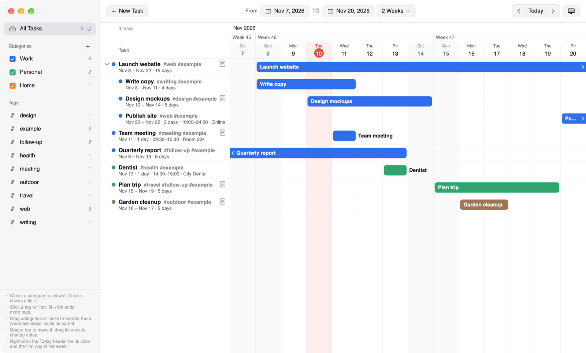

# DaySpindle for macOS

Version 2.1. Developed by Ruichen Li. Released under the [MIT License](../LICENSE).

[Main page](../README.md) · [Windows version](../Windows/README.md)

DaySpindle is a Gantt chart task manager. Plan **groups**, **tasks** and **milestones** on a day-by-day timeline. Join them with **dependency arrows**, color them by category, tag them, and drag their bars to reschedule. Everything is saved in a **workspace folder** you choose, which you can move to another computer or keep in iCloud Drive. It works fully offline: no account, no cloud service, no network access.



**Needs:** macOS 14 Sonoma or later, on Apple silicon or Intel.


## Getting started

1. **Download this repository.** On its [main page](../README.md), click the green **Code** button and choose **Download ZIP**, then double-click the downloaded zip. Or clone the repository with git. Open its `macOS` folder.
2. **Double-click `DaySpindle-2.1-macOS.zip`** in the `macOS` folder. `DaySpindle.app` appears next to it, beside the `Example Workspace` folder.
3. **Open `DaySpindle.app`.** It isn't from the App Store or notarized by Apple, so the first time macOS refuses to open it:
   - **macOS 15 and later:** click **Done**, open **System Settings › Privacy & Security**, scroll down to the message about DaySpindle, click **Open Anyway**, and confirm.
   - **macOS 14:** Control-click (or right-click) `DaySpindle.app`, choose **Open**, then **Open** again.

   macOS remembers your choice, so you do this only once.
4. **The Example Workspace opens by itself** on the first start when `DaySpindle.app` is in the `macOS` folder. If you see the welcome screen instead, choose **Open Workspace…** and pick the `Example Workspace` folder. This happens when macOS first runs a downloaded app from a temporary copy, or when you've already moved the app.

You can move `DaySpindle.app` to your Applications folder whenever you like; your workspaces stay where they are.


## The Example Workspace

The `Example Workspace` folder holds a small made-up plan:

- **Groups** (*Website redesign*, *Conference talk*, *Moving house*). A group spans everything inside it; drag it to move everything at once.
- **Tasks**, some with **milestones** drawn on their bars (*Design review*, *Client feedback*), and milestones with their own row (*Launch*, *Talk day*).
- **Arrows** between items, leaving and arriving at different sides: the usual end-to-start arrows, bottom-to-top arrows, and a red, thicker arrow.
- A **completed** task (*Submit abstract*), kept in the **Archive** (left sidebar) instead of the main list.
- A call entered in **Berlin time**, shown in your own time zone.

**Removing it:** close its tab (the **×** on the tab), then delete the `Example Workspace` folder in Finder. The note at the bottom left of the window says the same while it's open. Once its tab is closed, it doesn't open by itself again.

**Starting your own:** choose **File › New Workspace…** (⌃⌘N) and pick a folder, for example one in Documents or iCloud Drive (use **New Folder** in the dialog to make one). That folder itself becomes the workspace, and its tab is named after it.


## Upgrading from DaySpindle 2.0

DaySpindle 2.0 kept all your tasks in one file, `~/Library/Application Support/org.dayspindle.DaySpindle/dayspindle-data.json`. 2.1 keeps them in workspace folders and leaves that file as it is. To bring your tasks in:

1. In DaySpindle 2.1, choose **File › Import Tasks from DaySpindle 2.0…** (the welcome screen also has a button for it).
2. Choose a folder for them, for example a new folder `My Tasks` in Documents (use **New Folder** in the dialog). It becomes a workspace, and your tasks open in a tab named after it.

Tasks with subtasks become groups; dates, categories and tags stay as they were. Once your tasks are in 2.1, you can move the 2.0 app to the Trash.


## What you can do

- **Groups, tasks and milestones.** A task with subtasks becomes a group by itself. A milestone inside a task marks a key moment on its bar, such as a mid-term review or a deadline.
- **Dependency arrows.** Point at an item: four small round handles appear on its sides (left = its start, right = its end, top and bottom = the middle of its edges). Drag one onto another item. Each arrow's type (Finish → Start and so on), sides, thickness and color can be changed.
- **Details on the right.** Double-click an item or an arrow to see and edit everything about it in the pane on the right.
- **Completed and the Archive.** Mark an item as completed (**⇧⌘C**, the button in its details, or right-click) whether you finished on time or early; its dates stay as they were. It leaves the main list for the **Archive** (left sidebar, under All Items), together with everything inside it. Click **Archive** to see completed items, drawn faded with a check, and open their details. To bring one back, unmark it there (**Return from Archive** on right-click, ⇧⌘C, or the button in its details): it returns to exactly where it was. A milestone on a task's bar stays on the bar when completed and gets a check.
- **Time zones,** like Calendar. An item with a time keeps the moment it was entered in: a 10:00 meeting entered in Tokyo shows as 02:00 in Berlin. Items without a time keep their dates everywhere. Choose the time zone at the bottom of the sidebar.
- **Workspaces and tabs.** Each workspace is a folder; open several, each in its own tab along the top of the window.
- **Categories and tags** with checkboxes and filters, **undo** for every change, **light and dark** appearance.
- **Tips** at the bottom left of the sidebar: click **Tips** to unfold or fold them.


## Keyboard shortcuts

| Action | Keys |
|---|---|
| New task / subtask | ⌘N / ⌥⌘N |
| New milestone / group / category | ⇧⌘M / ⇧⌘G / ⇧⌘N |
| Show details / show or hide the details pane | ⌘E (or Return) / ⌥⌘I |
| Mark as completed (to the Archive) / return from the Archive | ⇧⌘C |
| Move up / down among its siblings | ⌥⌘↑ / ⌥⌘↓ |
| Delete the selected item or arrow | Delete |
| Undo / redo | ⌘Z / ⇧⌘Z |
| Go to today / previous or next period | ⌘T / ⌥⌘← or ⌥⌘→ |
| All items / clear filters | ⌘1 / ⌘K |
| New workspace / open workspace | ⌃⌘N / ⌘O |
| Next or previous workspace tab / close the tab | ⌘} or ⌘{ / ⇧⌘W |
| Settings | ⌘, |
| Cancel a drag or an arrow being drawn | Esc |


## Where your data is

- **In each workspace folder:** `dayspindle-data.json` (everything in the workspace) and `dayspindle-data.previous.json` (the file as it was when the workspace was last opened, as a backup).
- **Settings** (open tabs, time zone, appearance) are in the app's preferences, `org.dayspindle.DaySpindle`.
- DaySpindle 2.1 for Windows opens the same workspace folders, so a workspace can move between a Mac and a PC: copy the folder (or keep it in a shared folder such as iCloud Drive or Dropbox) and choose **File › Open Workspace…** on the other computer. Use one computer at a time.

DaySpindle doesn't connect to the internet, and it doesn't collect or send any data.


## What's in this folder

| | |
|---|---|
| `DaySpindle-2.1-macOS.zip` | The app (2.9 MB), for Apple silicon and Intel. Double-click to unzip it. |
| `Example Workspace/` | The example workspace. |
| `source/` | The app's source code (Swift and SwiftUI) and `build.sh`, which builds the zip. |
| `README.md` | This page. |
| `DaySpindle.app` | Not in the repository: unzipped on your Mac (and ignored by git). |


## Building from source

With Xcode or the Xcode Command Line Tools installed (`xcode-select --install`), run `./source/build.sh` in this folder. It compiles the app for Apple silicon and Intel, signs it ad hoc, and writes `DaySpindle-2.1-macOS.zip` again. Nothing else is needed.


## Removing DaySpindle

Delete `DaySpindle.app`. Your workspace folders stay where they are. To remove the settings too, run this in Terminal:

```bash
defaults delete org.dayspindle.DaySpindle
```


## Developer, license and disclaimer

- **Developer:** DaySpindle is developed by Ruichen Li.
- **License:** [MIT License](../LICENSE). Anyone may use, copy, change and share DaySpindle for free, for any purpose. When you share it, or a version you've changed, keep the copyright notice "Copyright (c) 2026 Ruichen Li" and the license text with it.
- **No warranty:** DaySpindle is provided "as is", without warranty of any kind. The developer isn't liable for any loss or damage from using it, including lost tasks. Keep your own backup of anything important.
- **Third-party software:** the Mac version uses only Apple's system frameworks. It includes no third-party code.
- **Trademarks:** Mac and macOS are trademarks of Apple Inc. DaySpindle isn't affiliated with or endorsed by Apple.
